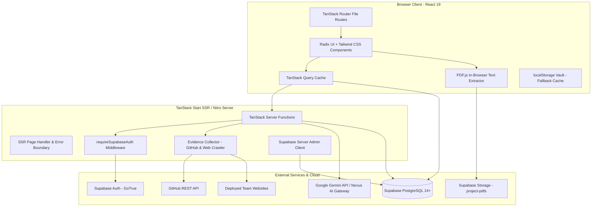
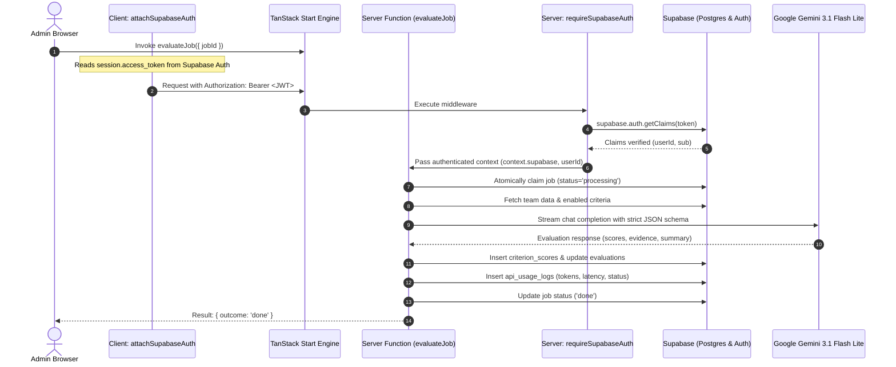

# INNOVEDGE Assessor Platform — System Architecture

## 1. System Topology & Architecture Overview



---

## 2. Frontend & Routing Architecture

### 2.1 File-Based Routing Model
The routing layer is built on `@tanstack/react-router` with automatic route tree compilation (`src/routeTree.gen.ts`).

- **Root Route (`src/routes/__root.tsx`)**:
  - Initializes `QueryClientProvider`, global styles (`styles.css`), fonts, and theme class toggling (`dark`/`light`).
  - Sets application metadata, favicon links, and registers top-level `NotFoundComponent` and `ErrorComponent`.
- **Public & Authentication Routes**:
  - `/` (`src/routes/index.tsx`): Redirects immediately to `/dashboard`.
  - `/auth` (`src/routes/auth.tsx`): Restricted admin sign-in with password visibility toggle, 3D animated hero (`CollaborationHero`), and password recovery trigger.
  - `/reset-password` (`src/routes/reset-password.tsx`): Password update form for valid recovery tokens.
- **Authenticated Route Layout (`src/routes/_authenticated/route.tsx`)**:
  - Acts as the layout guard for all protected routes.
  - Houses the persistent navigation sidebar/drawer, theme toggle, and `QueueRunnerProvider`.
- **Feature Routes (`src/routes/_authenticated/*.tsx`)**:
  - `/dashboard`: High-level metrics, team cards, live status, manual triggers.
  - `/teams`: Team directory, search, filter, and batch actions.
  - `/teams/new`: New team registration with mandatory problem statement and PDF validation.
  - `/teams/$id`: Team detail view, rubric inspection, overrides, and PDF print trigger.
  - `/teams/$id/edit`: Team editing with PDF replacement.
  - `/criteria`: Rubric criteria manager across `pdf`, `github`, and `website` components.
  - `/queue`: Real-time evaluation queue monitor, controls (start/pause), and job status table.
  - `/evaluations`: Consolidated score table with score breakdown dialogs.
  - `/leaderboard`: Official ranking table using standard competition ranking with tie flags.
  - `/qualification`: Shortlisting console with 1-click qualification toggles and cutoff filters.
  - `/plagiarism`: Dedicated originality scanner, similarity heatmaps, and penalty controls.
  - `/problem-statements`: Challenge tracks management.
  - `/reports`: Export hub for qualified teams, full evaluation reports, and CSV/XLSX downloads.
  - `/usage`: AI token consumption charts, model distribution, and cost analytics.
  - `/settings`: Global parameters (model, RPM, concurrency, max PDF size, scoring weights).
  - `/activity`: Audit trail of administrative mutations and score changes.

### 2.2 Client State & Query Management
- Data fetching is powered by `@tanstack/react-query` v5 (`src/lib/queries.ts`).
- Query keys are scoped consistently: `["team-rows"]`, `["weights"]`, `["settings"]`, `["jobs"]`, `["problem-statements"]`.
- `staleTime` is configured globally at 60 seconds, with `gcTime` at 10 minutes. Real-time Supabase channels invalidate queries on Postgres changes (`evaluation_jobs`, `evaluations`).

---

## 3. Server Architecture & Supabase Integration



### 3.1 Server Function Execution Model
- Defined in `src/lib/evaluate.functions.ts` via `createServerFn`.
- Client requests automatically bundle the Supabase bearer token via `attachSupabaseAuth` registered in `src/start.ts`.
- Server handlers enforce identity via `requireSupabaseAuth` (`src/integrations/supabase/auth-middleware.ts`), which validates the JWT claims and constructs an authenticated PostgREST client.

### 3.2 Dual Supabase Clients
1. **Browser Client (`src/integrations/supabase/client.ts`)**:
   - Uses `createClient<Database>(SUPABASE_URL, SUPABASE_PUBLISHABLE_KEY)`.
   - Persists session in `localStorage` with `autoRefreshToken: true`.
   - Used for direct client reads and subscriptions.
2. **Server Admin Client (`src/integrations/supabase/client.server.ts`)**:
   - Uses `SUPABASE_SERVICE_ROLE_KEY` to bypass Row Level Security when needed for administrative background tasks.
   - *Security Rule*: Must never be imported into client code.

---

## 4. AI Evaluation & Evidence Gathering Architecture

### 4.1 Multi-Modal Evidence Ingestion
- **PDF Text Pipeline (`src/lib/pdf.ts`)**:
  - Uses `pdfjs-dist` inside a Web Worker.
  - Extracts text page-by-page up to 60 pages and 60,000 characters.
  - Stores normalized text in `teams.pdf_text`.
- **GitHub Pipeline (`src/lib/evidence.server.ts`)**:
  - Validates repository format and owner/repo slug.
  - Queries GitHub API (`/repos/{owner}/{repo}`) and Git tree endpoint (`/git/trees/{branch}?recursive=1`).
  - Ranks files using a domain-heuristic score prioritizing READMEs, package configs, source roots (`src/`, `lib/`), and business logic files while excluding binary assets, vendor code, and lockfiles.
  - Fetches raw contents of the top 14 files up to 40,000 characters total.
  - Respects rate limits using `GITHUB_TOKEN` when configured.
- **Website Pipeline (`src/lib/evidence.server.ts`)**:
  - Issues static HTTP GET request with 12s timeout and Follow Redirects.
  - Parses document title, meta descriptions, mobile viewport readiness, headings, buttons, forms, and client script clues.
  - Crawls up to 3 same-origin internal links.
  - Explicitly documents that static inspection cannot execute client-side JavaScript.

### 4.2 Gemini Prompt Engineering & Schema Enforcement
- Model: `gemini-3.1-flash-lite` (or fallback `google/gemini-3.1-flash-lite`).
- Endpoint: Direct Google Gemini API endpoint (`https://generativelanguage.googleapis.com/v1beta/openai/chat/completions`) or fallback Nexus AI Gateway.
- Prompt Structure:
  - System message injects component focus (`FOCUS[component]`), administrator custom scoring instructions, and the active rubric criteria with individual `max_marks`.
  - User message passes team name, project title, description, and the gathered evidence.
  - Structured output enforced via JSON Schema:
    ```json
    {
      "summary": "string",
      "confidence": "number",
      "criteria": [
        {
          "criterion_id": "string",
          "marks": "number",
          "explanation": "string",
          "evidence": "string",
          "confidence": "number",
          "insufficient_evidence": "boolean"
        }
      ]
    }
    ```
- Server-Side Guardrails:
  - Validates that every enabled criterion is scored exactly once.
  - Clamps marks strictly to `[0, criterion.max_marks]`.
  - Flags evaluation for human review (`needs_review = true`) if marks are missing, confidence is below 0.5, or AI reported `insufficient_evidence`.

---

## 5. Plagiarism & Originality Detection Architecture

```mermaid
flowchart LR
    A[Raw Text / Code Tokens] --> B[Boilerplate Filter]
    B --> C[4-Gram Shingle Generator]
    C --> D[Shingle Set Construction]
    D --> E[Jaccard Index Intersection: |A ∩ B| / |A ∪ B|]
    E --> F[Similarity Score %]
    
    G[Normalized GitHub URLs] --> H{Exact Match?}
    H -->|Yes| I[Flag Duplicate Repo: High Severity]
    H -->|No| J[Evaluate Similarity %]
    
    F & I & J --> K[Composite Plagiarism Profile]
    K --> L[Admin Verdict Action]
```

- **Algorithms**: Jaccard similarity over $n$-grams (shingles with $n=4$).
- **Boilerplate Exclusion**: Filters common imports, React hooks, Express boilerplate, and Tailwind configuration signatures.
- **Duplicate URL Scanner**: Case-insensitive and protocol-normalized matching across all team repositories.
- **Severity Thresholds**:
  - `clean`: Similarity < 30% and no duplicate repo.
  - `low`: Similarity 30% - 49%.
  - `medium`: Similarity 50% - 69%.
  - `high`: Similarity >= 70% or duplicate repository detected.

---

## 6. Evaluation Queue & Concurrency Model

- Queue table: `public.evaluation_jobs`.
- **Atomic Locking Mechanism**:
  ```sql
  UPDATE public.evaluation_jobs
  SET status = 'processing', updated_at = NOW()
  WHERE id = $jobId AND status = 'queued'
  RETURNING *;
  ```
  Prevents race conditions when multiple workers or concurrent queue loops are active.
- **Rate-Limiting & Backoff**:
  - Configurable RPM (`rpm`, default 15) and concurrency (`concurrency`, default 2).
  - Daily request cap (`daily_request_limit`, default 1000).
  - Handles HTTP 429 by setting `retry_after` backoff and HTTP 402/403 by toggling `quota_exhausted = true` and pausing the queue.
- **Stale Evaluation Invalidation**:
  - Database trigger `criteria_stale` triggers `public.mark_stale()` when criteria change, automatically marking existing evaluations as `stale = true`.

---

## 7. Key Architectural Decisions (ADRs)

1. **ADR-01: Single-Administrator Dedicated Security Model**
   - *Decision*: Restrict all administrative operations to `TeamInoSap26@gmail.com`.
   - *Rationale*: Hackathon assessment requires strict confidentiality and integrity; student registrations are disallowed to prevent tampering with rubric marks or viewing peer evaluations.
2. **ADR-02: Structured AI Output with Schema Validation**
   - *Decision*: Enforce strict JSON Schema on Gemini outputs and validate in server functions.
   - *Rationale*: Prevents prompt injection, hallucinated scoring rubrics, out-of-bounds marks, and malformed responses.
3. **ADR-03: Separation of AI Scores and Approved Scores**
   - *Decision*: `evaluations` table maintains distinct `ai_score` and `final_score` columns; final score requires administrator approval or override.
   - *Rationale*: Preserves human-in-the-loop integrity; AI provides recommendations and evidence citations, but official awards require human administrator accountability.
4. **ADR-04: Static Code & Web Inspection Without Execution**
   - *Decision*: Inspect code via GitHub tree APIs and website HTML via standard fetch; do not execute arbitrary student scripts.
   - *Rationale*: Zero risk of malicious code execution, container escape, or resource exhaustion on the assessment server.
