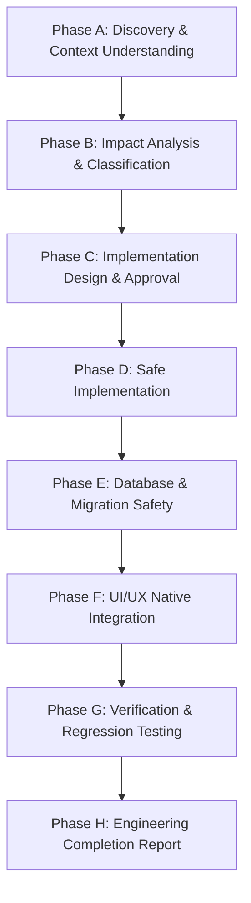

# INNOVEDGE Assessor Platform — Feature Implementation Playbook

## 1. Overview & Operating Principle
This playbook defines the permanent, mandatory protocol for implementing any feature, enhancement, integration, or refactoring in the INNOVEDGE Assessor Platform repository.

Every future task must execute through these defined phases to maintain architectural continuity, data integrity, and strict security.

---

## 2. Phase-by-Phase Implementation Protocol



### Phase A: Discovery & Context Understanding
Before creating or modifying any file:
1. Identify the exact user goal and problem statement.
2. Search the existing codebase for existing utilities, components, schemas, or server functions that already handle similar tasks:
   - Shared components: `src/components/ui/`, `src/components/`
   - Business logic: `src/lib/`
   - Database queries: `src/lib/queries.ts`, `src/lib/db.ts`
   - Server functions: `src/lib/evaluate.functions.ts`
   - Routes: `src/routes/_authenticated/`
3. Identify existing business rules and constraints that apply to the domain entity.
4. Verify if database tables or migrations already touch this area.

### Phase B: Impact Analysis & Scope Classification
Prepare a mental or documented Impact Map:
- **Files to Modify**: Exact file paths and line ranges.
- **Files to Create**: New modular files following naming conventions.
- **Database Tables Affected**: Columns, constraints, foreign keys, or RLS policies.
- **Server Functions Affected**: Endpoints, authentication middleware, error handling.
- **Existing Workflows at Risk**: Regression paths that must be checked.

**Scope Classification**:
- `Small`: Isolated UI tweak, minor utility function, CSS/layout adjustment.
- `Medium`: New route, new modal component, or updating an existing business logic module.
- `Large`: Adding a new evaluation component, modifying multi-table queries, or adding new database tables.
- `Critical`: Modifying authentication, authorization guards, RLS policies, scoring calculations, or payment/quota logic.

### Phase C: Implementation Design
For medium, large, or critical features:
1. **Data Flow**: Detail how data travels from user action -> TanStack Query / Server Function -> Supabase -> Response -> UI feedback.
2. **Authorization Boundary**: Ensure privileged operations verify `requireSupabaseAuth` on the server and check `public.is_admin(auth.uid())` in the database.
3. **Error Handling & Feedback**: Define explicit states for:
   - Initial / Idle state
   - Loading / Busy state (spinners, disabled buttons)
   - Empty state (`Empty` component from `src/components/page-header.tsx`)
   - Success toast feedback (`toast.success`)
   - Descriptive error toast feedback (`toast.error`)
4. **Validation**: Define Zod schemas for all client and server inputs.

### Phase D: Safe Implementation Rules
1. **Preserve Existing Architecture**: Do not introduce alternative state management, alternative ORMs, or competing UI libraries.
2. **Server-Side Security**: Never put API keys, service role keys, or secrets into client files.
3. **True Persistence**: Never simulate database persistence using `localStorage` fallbacks. If a database operation fails, throw or propagate the error; never display a fake success toast.
4. **Clean Code**: Follow strict TypeScript typing. Do not bypass types with `any` unless working with dynamic JSON payloads where schema parsing is explicitly performed.

### Phase E: Database & Migration Safety
If the feature requires database modifications:
1. Inspect the existing schema in `drizzle/migrations/0000_migration.sql` and `0001_restrict_admin_and_require_complete_projects.sql`.
2. Create a new forward-only migration file: `drizzle/migrations/000X_<descriptive_name>.sql`.
3. Never edit past migrations.
4. Always enable Row Level Security on new tables:
   ```sql
   ALTER TABLE public.<table_name> ENABLE ROW LEVEL SECURITY;
   CREATE POLICY "admin all" ON public.<table_name>
     FOR ALL TO authenticated
     USING (public.is_admin(auth.uid()))
     WITH CHECK (public.is_admin(auth.uid()));
   GRANT ALL ON public.<table_name> TO authenticated, service_role;
   ```
5. Update `src/integrations/supabase/types.ts` to reflect new tables and columns.
6. **Destructive Approval Gate**: Never drop columns or tables without explicit user confirmation.

### Phase F: UI/UX Native Integration
1. Reuse Radix UI primitives located in `src/components/ui/`.
2. Follow the INNOVEDGE visual language:
   - Glassmorphic panels: `glass`, `rounded-2xl`, `p-6`
   - Headers: `PageHeader` from `src/components/page-header.tsx`
   - Badges: `StatusBadge` from `src/components/page-header.tsx`
   - Typography: Font families `font-display` (Sora), `font-sans` (Manrope), `font-mono` (JetBrains Mono).
3. Ensure responsiveness on mobile viewports (`sm:`, `md:`, `lg:` breakpoints).
4. Provide accessible keyboard and screen-reader semantics.

### Phase G: Verification & Regression Testing
After implementation, execute the automated verification suite:
1. **Automated Unit & Integration Tests**:
   ```powershell
   pnpm test
   ```
2. **Production Compilation**:
   ```powershell
   pnpm build
   ```
3. **Lint & Code Style**:
   ```powershell
   pnpm lint
   ```
4. **Manual Functional Walkthrough**:
   - Verify success path.
   - Verify validation rejection on empty/invalid inputs.
   - Verify unauthenticated rejection on server functions.
   - Verify error feedback on network failure.

### Phase H: Engineering Completion Report
Always conclude every feature implementation with the standard 7-section report:
1. **Implementation Summary**: Technical overview of what was built and how it functions.
2. **Files Changed**: Comprehensive list of added, edited, or deleted files with purpose.
3. **Database Changes**: Migrations, tables, constraints, indexes, and RLS policies created.
4. **Security Analysis**: Verification of authorization boundaries, input sanitization, and secrets containment.
5. **Testing & Verification Results**: Exact status of `pnpm test`, `pnpm build`, and lint checks.
6. **Remaining Work / External Dependencies**: Any pending environment variables, manual Supabase deployments, or approval gates.
7. **Final Status**: Explicit completion verdict (`Complete and verified`, `Implemented but partially verified`, or `Blocked`).
