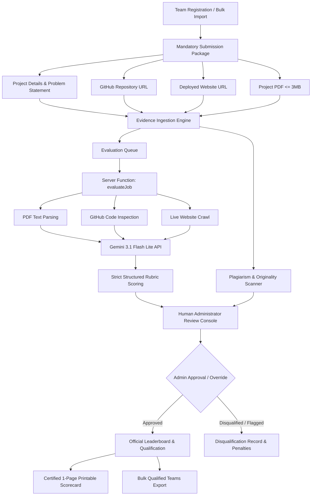

# INNOVEDGE Assessor Platform — Product & Project Context

## 1. Executive Summary & Vision
The **INNOVEDGE Assessor Platform** is the dedicated, AI-assisted project evaluation, originality verification, team qualification, and certified scorecard generation platform for INNOVEDGE Hackathons.

Unlike generic form submissions or subjective manual grading spreadsheets, INNOVEDGE Assessor automates multi-modal evidence collection (PDF proposals, GitHub repositories, and deployed web prototypes), processes them through Google Gemini 3.1 Flash Lite with strict rubric constraints, detects cross-submission text and code plagiarism, and allows the single authorized administrator to review, override, and certified-qualify teams for subsequent rounds.

---

## 2. Target Users & Access Control
- **Primary User**: Hackathon Evaluation Administrator (Designated Account: `TeamInoSap26@gmail.com`).
- **Access Pattern**: Single-tenant admin model. Public user registration is explicitly disabled. Non-administrator accounts are denied access by both client route guards and PostgreSQL Row Level Security.
- **Audience of Output**: Hackathon organizing committees, judges, mentors, and student participant teams receiving certified 1-page printable scorecards.

---

## 3. Core System Workflows

### Workflow 1: Team Ingestion & Data Preparation
- **Single Entry**: Administrators add teams manually (`/teams/new`) with team name, contact email, selected problem statement, project description, GitHub URL, live website link, and mandatory PDF presentation (<= 3 MB).
- **Bulk Import**: Administrators upload CSV/Excel sheets (`/import`) containing bulk team metadata along with associated PDF files mapped by filename.
- **PDF Extraction**: PDF text is extracted in the browser using PDF.js and stored in `pdf_text` for downstream AI ingestion.

### Workflow 2: Automated Multi-Modal AI Evaluation
- Evaluations are partitioned into three weighted components:
  1. **Project PDF (`pdf`)**: Evaluates problem statement clarity, proposed methodology, technical architecture, and impact.
  2. **GitHub Code (`github`)**: Analyzes modularity, code quality, defensive typing, error handling, security practices, and README completeness (inspecting top 14 code files without executing arbitrary code).
  3. **Deployed Website (`website`)**: Validates live UI design, responsiveness, accessibility, backend/API hints, and UX.
- The evaluation queue processes active jobs subject to rate limits, concurrency caps, and daily token quotas.

### Workflow 3: Plagiarism & Originality Detection
- **Text & Proposal Comparison**: Scans extracted PDF text across all peer teams using Jaccard similarity on 4-gram shingles.
- **Repository Duplication Check**: Identifies identical GitHub repositories submitted across multiple team records.
- **Boilerplate Filtering**: Ignores common hackathon boilerplate patterns (React/Vite starter templates, Express configs).
- **Admin Verdicts**: Flagged teams can be reviewed, dismissed as clean, assigned point deductions (-20 pts default), or disqualified with 0 marks.

### Workflow 4: Scoring, Overrides & Qualification Decisions
- Standard weighting: **30% PDF + 40% GitHub + 30% Website = 100% Final Score**.
- An evaluation is only official when all components are approved or an explicit administrator override is applied.
- Administrators can set score overrides with mandatory logged reasons.
- 1-click qualification toggles qualify or disqualify teams for Round 2, filtering against customizable cutoff thresholds.

### Workflow 5: Certified Reports & Scorecards
- **1-Page Printable Scorecard**: Certified document formatted for standard printing/PDF export, featuring the INNOVEDGE emblem watermark, rubric breakdown, dynamic improvement recommendations, and verification hash.
- **Data Exports**: Tabular exports in CSV and XLSX for qualified teams, ranking lists, and detailed audit logs.

---

## 4. Core Domain Entities & Database Schema

| Entity | PostgreSQL Table | Primary Purpose |
| :--- | :--- | :--- |
| **Team** | `public.teams` | Project submission, links, PDF path/text, final status, override values. |
| **Team Member** | `public.team_members` | Student names, emails, and roster position within a team. |
| **Problem Statement** | `public.evaluation_templates` | Hackathon challenge tracks with category, requirements, and codes. |
| **Component** | `public.evaluation_components` | Top-level evaluation buckets (`pdf`, `github`, `website`) and weights. |
| **Criterion** | `public.evaluation_criteria` | Individual rubric items per component with max marks, position, and instructions. |
| **Evaluation** | `public.evaluations` | Component-level status, AI score, approved score, confidence, and summary. |
| **Criterion Score** | `public.criterion_scores` | Granular mark, AI explanation, evidence quote, and admin override per criterion. |
| **Job Queue** | `public.evaluation_jobs` | Asynchronous evaluation jobs with retry tracking and atomic locking. |
| **Score Override** | `public.admin_score_overrides` | Audit history of manual score interventions with reason and previous values. |
| **History Log** | `public.evaluation_history` | Historical timeline of evaluations, re-evaluations, and status transitions. |
| **Activity Log** | `public.activity_logs` | Administrative action trail (teams edited, queue started, settings saved). |
| **API Usage Log** | `public.api_usage_logs` | Token consumption, latency, HTTP status, and estimated USD costs per AI call. |
| **System Settings** | `public.system_settings` | Global singleton (ID=1) controlling model, RPM, concurrency, limits, and queue pauses. |

---

## 5. Critical Business Rules
1. **Designated Administrator Only**: All operations are restricted to `TeamInoSap26@gmail.com`. No secondary admin or student accounts may authenticate.
2. **Project Completeness Constraint**: A team record is invalid unless it contains:
   - Name (1-100 characters)
   - Valid contact email
   - Project title (1-200 characters)
   - Project description (1-10,000 characters)
   - Valid GitHub URL matching `^https://(www\.)?github\.com/[^/]+/[^/?#]+/?`
   - Valid HTTP/HTTPS website URL
   - Valid PDF uploaded to `project-pdfs` bucket with size <= 3 MB (3,145,728 bytes).
3. **Strict Scoring Bounds**: Criterion marks cannot exceed `max_marks` or fall below 0.
4. **Weighted Final Calculation**: Final score is calculated only when all required components have approved marks. Missing components are never treated as zero; the final score remains `null` until all components are resolved or overridden.
5. **No Blind AI Trust**: If AI evaluation confidence is below 0.5 or evidence is insufficient, `needs_review` must be set to `true` to mandate administrator sign-off.

---

## 6. Important System Limitations
1. **Static Inspection of Repositories & Websites**: The server inspects public GitHub files via API and public HTML pages via static HTTP requests. It never executes arbitrary code, does not build Docker images, and does not run headless browsers with client-side JavaScript execution. Client-rendered single-page applications without server-side rendering may yield limited text evidence.
2. **AI Rate Limits & Quotas**: Free-tier Gemini endpoints are subject to RPM caps and daily request quotas. The system implements exponential backoff and automatic queue pausing on HTTP 429/402.
3. **Database vs. Browser Cache Duality**: In current code, some components write to browser `localStorage` as a fallback. As identified in the technical debt audit, this duality must be unified so that Supabase PostgreSQL remains the single source of truth.
